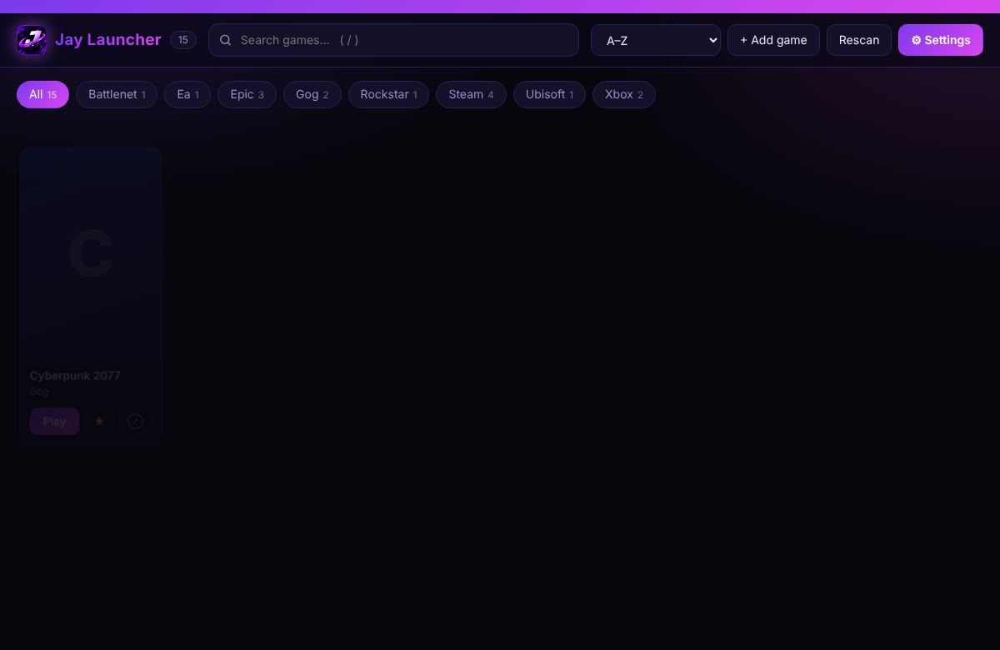
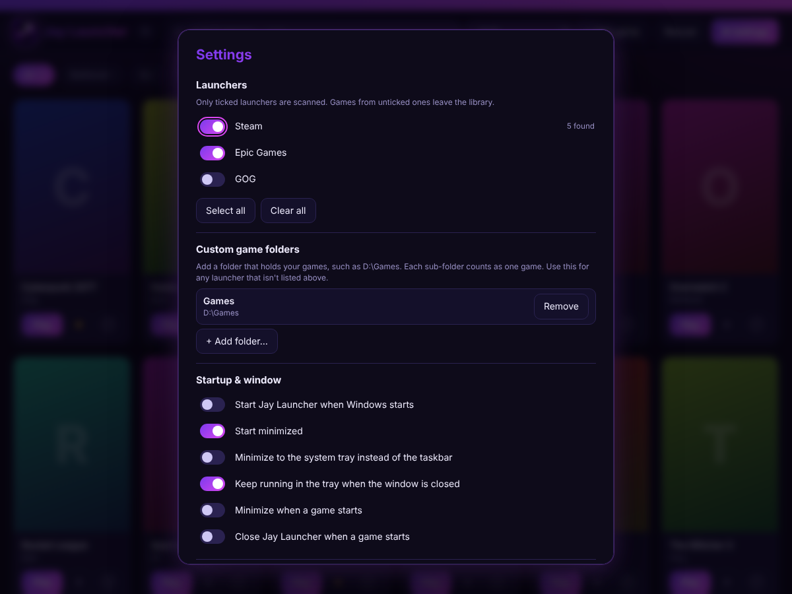

<div align="center">


# Jay Launcher

**All your PC games from every launcher, in one place.**

Designed by **Jayden M.**

[Download the latest installer](../../releases/latest) · [Report a problem](../../issues) · [Security](SECURITY.md)



</div>

---

## What it does

Jay Launcher looks at the game launchers installed on your PC and shows every game in one library. Press **Play** and it starts the game through the right launcher.

- One library for Steam, Epic, GOG, Ubisoft Connect, EA app, Battle.net, Xbox / Game Pass and Rockstar
- Search, sort (A–Z, recently played, favorites first) and filter by launcher
- Favorites, and **exclude / include** to keep unwanted games out of the library
- Add any game yourself, or point it at a folder such as `D:\Games`
- Runs in the system tray, starts with Windows and starts minimized if you want
- Updates itself from GitHub Releases
- Works offline. Nothing is uploaded anywhere

## Install

1. Download `Jay-Launcher-Setup-x.y.z.exe` from the [latest release](../../releases/latest).
2. Run it. **Tick the launchers you want supported.** Nothing is ticked by default, and *Select all* is there if you want everything.
3. Finish the installer and open Jay Launcher. It scans straight away.

> **Windows SmartScreen:** the installer isn't code-signed yet, so Windows may say "Windows protected your PC". Choose **More info → Run anyway**. Signing certificates cost money; this goes away if one is added later.

You never need PowerShell or a command prompt.

## Using it

| Do this | How |
|---|---|
| Start a game | **Play** on its card |
| Favorite a game | ☆ on the card |
| Exclude a game | ⊘ on the card. A toast offers **Undo** |
| Include it again | **Settings → Excluded games** |
| Search | Press **/**, then type. **Esc** clears the search |
| Add a game | **+ Add game**, then choose its `.exe` |
| Add a launcher later | **Settings → Launchers** |
| Scan a folder | **Settings → Custom game folders** |

### Settings



- **Launchers:** choose which ones are scanned, with *Select all* / *Clear all*
- **Custom game folders:** every sub-folder counts as one game
- **Startup & window:** start with Windows, start launchers in the background (Steam and Epic), start minimized, minimize to tray, keep running in the tray when closed, minimize or close when a game starts
- **General:** scan on start, automatic updates, card size, default sort
- **Excluded games:** list with *Include* and *Include all*

Closing to the tray keeps the app running. Use the tray icon's menu (**Open**, **Rescan games**, **Quit**) to control it. Only one copy runs at a time; starting it again brings the open window forward.

## Supported launchers

| Launcher | Found by reading |
|---|---|
| Steam | library folders and app manifests |
| Epic Games | Epic's install manifests |
| GOG Galaxy | registry entries for installed games |
| Ubisoft Connect | registry install entries |
| EA app | installed-game data files |
| Battle.net | Blizzard's install registry keys |
| Xbox / Game Pass | installed Microsoft Store game packages |
| Rockstar Games | registry install entries |
| Anything else | add its folder under **Custom game folders**, or use **+ Add game** |

## Privacy and security

- **Local only.** No account, no telemetry, no analytics. Your library and settings stay in `%APPDATA%\Jay Launcher`.
- **Only three network uses:** Steam cover images (`cdn.cloudflare.steamstatic.com`), checking GitHub Releases for updates, and an optional lookup of missing covers by game title on Steam's store. Turn the lookup off in **Settings → General**.
- **Locked-down window:** context isolation and sandbox on, Node.js off in the page, strict Content-Security-Policy, no pop-ups, no navigation away, no web permissions, developer tools off in release builds.
- **Checked launching:** a game can only start through a known launcher link, a valid Xbox app ID or a local `.exe`/`.lnk`/`.bat` path. Network paths and crafted values are refused, and only your own window can send commands to the app.
- **Hardened Electron:** current Electron release with the `RunAsNode`, `NODE_OPTIONS` and inspector switches disabled, and the app loadable only from its packed archive.
- **Safer builds:** GitHub Actions runs with least-privilege permissions, and Dependabot proposes dependency updates weekly.

To report a vulnerability, see [SECURITY.md](SECURITY.md).

## FAQ

**A game is missing.** Open **Settings** and check its launcher is ticked, then press **Rescan**. If the launcher isn't listed, add the game folder under **Custom game folders**.

**A game shows no cover art.** Steam games use Steam's covers. For other launchers, Jay Launcher uses the game's own logo or icon when it can, otherwise looks the title up on Steam's store, and otherwise shows a coloured tile with the first letter. Lookups happen in the background after a scan, so covers appear a moment later. If a game has no match, nothing more can be done automatically.

**I excluded a game by mistake.** Press **Undo** in the toast, or use **Settings → Excluded games**.

**The window disappeared.** If *Keep running in the tray* is on, the app is in the system tray. Click its icon.

**How do I stop it starting with Windows?** Turn off **Start Jay Launcher when Windows starts** in Settings.

## Build it yourself

You need Windows and [Node.js](https://nodejs.org) 22 or newer.

Double-click **`build.bat`**. It installs everything, builds the installer and puts it in `dist/`. It asks for administrator rights once, which Windows needs while unpacking the build tools.

Or from a terminal in the project folder:

```
npm install
npm test
npm start          # run in development
npm run dist       # build the installer
```

After the first `npm install`, commit the generated `package-lock.json`. The build on GitHub then installs the exact same versions every time.

## Publishing an update

1. Raise `version` in `package.json` and commit.
2. On GitHub open **Actions → Build installer → Run workflow**, tick **Publish a Release**, and run it.
3. Installed copies download the new version in the background and offer **Restart to update**.

## Adding a launcher

Each launcher is a small file in `scanners/` that returns `{ name, scan() }`. Add the file, register it in `scanners/index.js` and `config.js`, and add a checkbox to `build/installer.nsh`.

## Project layout

```
main.js          app window, tray, updates, launching
security.js      checks for links, app IDs and paths
config.js        settings and launcher list
art.js           finds cover art for non-Steam games
library.js       saved games, favorites, exclusions
scanners/        one file per launcher
renderer/        the interface
build/           installer script, icons, security-hardening step
tests/           unit tests
```

## License

Copyright © 2026 Jayden M. All rights reserved. See [LICENSE](LICENSE).

*Screenshots use sample data.*
